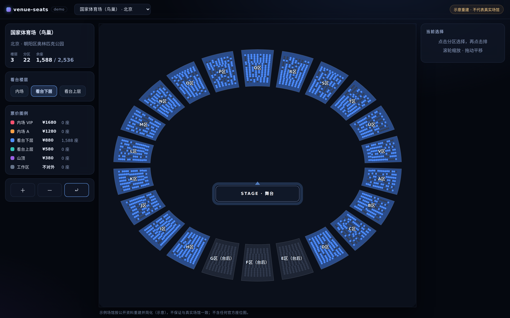

# venue-seats

  
  
  
  
  
  
  
  

场馆座位图库：数据模型 + JSON Schema + 渲染器，一个数据格式，三端可用。

| 端 | 包 | 状态 |
|---|---|---|
| React | `@venue-seats/react` | 源码可用，未发 npm |
| Vue | `@venue-seats/vue` | 源码可用，未发 npm |
| Flutter | `packages/venue_seats`（Dart） | 源码可用，未发 pub |

## 示例

`apps/demo` 是 Vite 示例应用：楼层切换、票价图例、区/排两级选择、缩放拖动、
售罄态、2D/3D 视图切换（共用选中状态），渲染 5 个示例场馆。

其余状态截图见 [`docs/screenshots/`](docs/screenshots)：楼层切换、票档配色、
选区选排、悬停提示、售罄分区、八边形 arena 场馆。

示例场馆 5 个（按公开资料重建并简化，`provenance: demo`）：国家体育场（鸟巢）、
上海体育场、梅赛德斯-奔驰文化中心、凯迪拉克中心（五棵松）、深圳湾体育中心体育馆。
**不保证与真实场馆一致；不收录任何官方座位图。**

## 为什么开这个项目

开源世界的中国场馆座位数据接近为零，商业方案（seats.io、seatmap.pro、SeatLayer）
要么收授权费、要么渲染器闭源。本项目做干净的自研实现，核心 MIT：

- 不抄任何商业项目的代码、素材、座位数据；
- 示例场馆按公开资料重建，明确标注 `demo` / **示意**，不保证与真实场馆一致；
- 官方座位图受版权保护，仓库不收录、不爬取。

## 分期

- **L1 已完成**：选区、选排（中国大型体育馆/演唱会场馆最常用的粒度）
- **L2 已完成**：逐座选择交互（座位可见后点选切换选中，`onSeatToggle` / `onSeatActivated` 回报新状态；不影响 L1 选区/选排）
- **L3 已完成**：3D 视图（three.js 程序化几何：拉伸分区 + 实例化座位球 + 舞台；与 2D 共用同一份文档与选中状态，demo 可一键切换 2D/3D；低端机或无 WebGL 自动回 2D）

## 质量标尺

对标商业级交互：缩放/拖动顺滑、悬停高亮、售罄置灰、票价分区配色、舞台朝向、
楼层切换、键盘与无障碍可用。**看商业产品做参考可以，抄它的代码/素材/数据不行。**

## 数据格式

见 [`schemas/venue-seats.schema.json`](schemas/venue-seats.schema.json) 与
[`docs/data-format.md`](docs/data-format.md)。英文文档见 [README.md](README.md)。
